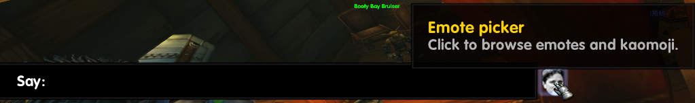
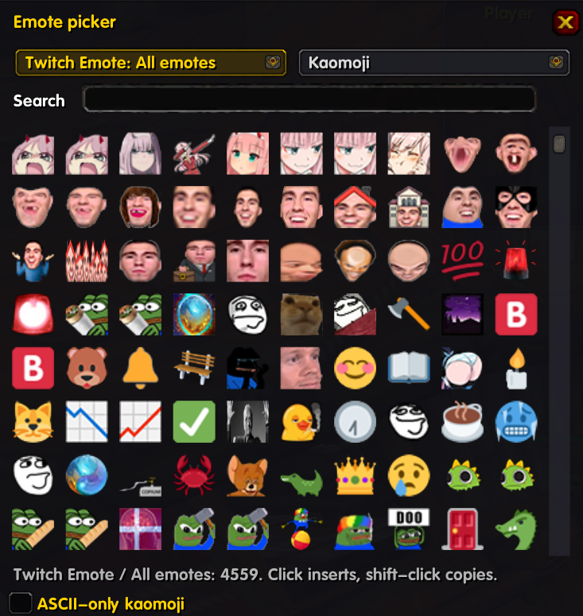
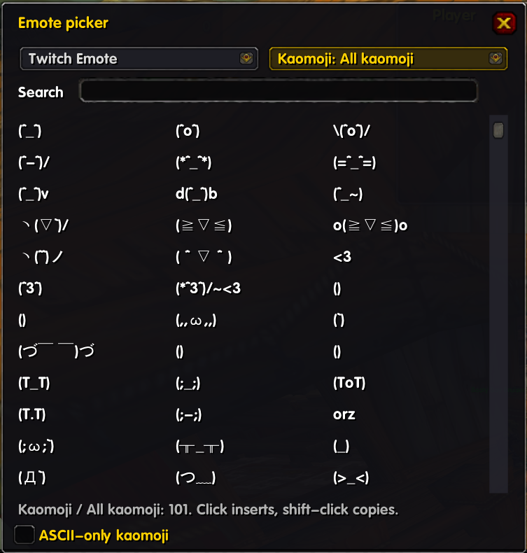

# TwitchEmotes+

A companion add-on for [TwitchEmotes](https://github.com/brues-code/TwitchEmotes), the vanilla 1.12.1 backport by Brues of the retail add-on by Ren. It adds a **scrolling emote picker** opened from a button on the chat edit box, and a **kaomoji** (Japanese emoticon) library, without modifying a single TwitchEmotes file.

## Required client mod

| DLL | What this add-on uses it for |
|---|---|
| [`ClassicAPI.dll`](https://github.com/brues-code/ClassicAPI) | The Lua 5.1 syntax the add-on is written in, positional script arguments, and `CopyToClipboard` (shift-click copies). Without it only a tiny `Gate.lua` loads and prints a one-line warning, the same way TwitchEmotes gates itself. |

That is the only client mod used. TwitchEmotes states which ClassicAPI version it needs in its own README; check it there, since that changes between releases. TwitchEmotes itself is optional: without it the kaomoji half still works, and the emote packs need it.

## Screenshots

**The button.** It sits at the right end of the chat edit box while you are typing.



**Twitch Emote dropdown.** Every emote from TwitchEmotes in a scrolling grid (4559 in the screenshot), with a container per emote pack.



**Kaomoji dropdown.** Kaomoji and classic text smileys in categories. Plain-ASCII ones render in any font; see [Kaomoji and fonts](#kaomoji-and-fonts) for the others.



## Features

- **Picker button** beside the chat edit box. It shows while you are typing; `/tep always` keeps it visible.
- **Two separate dropdowns**, **Twitch Emote** and **Kaomoji**, each opening a scrolling menu of containers.
  - *Twitch Emote*: Recent, All emotes, then one container per emote pack.
  - *Kaomoji*: Recent, All kaomoji, then one container per category: Happy, Excited, Love, Sad, Angry, Surprised, Confused, Shy, Shrug and meh, Cool and sleepy, Animals, Actions, Table flip, Greetings, Classic smileys, Objects, Extended (needs glyphs).
- **Virtualized grid.** Only about 80 buttons exist however many emotes are installed, so thousands of emotes scroll smoothly with the mouse wheel or the slider. Long dropdown menus scroll the same way.
- **Packs discovered automatically** from the folder each emote lives in, so packs added by future TwitchEmotes releases show up with no change here.
- **Animated icons** in the grid for sprite-sheet emotes, using the same frame layout as TwitchEmotes.
- **Search** across all emotes, or all kaomoji, depending on which dropdown is active. Kaomoji are searchable by meaning (`shrug`, `hug`, `flip`, `cat`).
- **256 kaomoji and text smileys in 17 categories**, mostly plain ASCII because that is what the default fonts can draw.
- **Recent** emotes and kaomoji, remembered between sessions.
- **ASCII-only filter** that hides kaomoji needing special glyphs (191 of the 256 are plain ASCII).
- **Click to insert** at the cursor, **shift-click to copy** to the Windows clipboard.
- **Edit box recovery.** If the chat edit box closes when you click into the search field, what you had typed is restored when you pick something.

### Commands

| Command | Does |
|---|---|
| `/tep` | toggle the picker |
| `/tep status` | show what was detected: TwitchEmotes data, catalog size, client mods |
| `/tep ascii` | toggle ASCII-only kaomoji |
| `/tep always` | keep the button visible even when not typing |

## Kaomoji and fonts

The default 1.12 fonts contain no Japanese or symbol glyphs. In the screenshot above, plain-ASCII kaomoji such as `(T_T)`, `(>_<)` and `orz` render correctly, while characters outside ASCII (kana, hearts, many symbols) can show blank or wrong. The same applies in chat: the kaomoji are sent as UTF-8 and display correctly only where the chat font has the glyphs.

Use the **ASCII-only kaomoji** checkbox (or `/tep ascii`) to hide the 65 that need special glyphs. A chat font with wider glyph coverage makes them render.

## Adding more emotes

Emote art comes from TwitchEmotes, so new emotes are added there, not here. TwitchEmotes ships an installer that takes a BetterTTV emote, converts it to a texture the 1.12 client can decode, and registers it:

```
python tools/add_emote.py https://betterttv.com/emotes/<id> PepeCool
```

TwitchEmotes+ builds its lists from TwitchEmotes' own tables each session, so emotes added that way (and new packs from future releases) should appear in the Twitch Emote dropdown after a `/reload`, with no change here.

New kaomoji go in `Data/Kaomoji.lua`, or can be supplied by another add-on by overriding the `kaomojiSource` service (see below).

## Built to survive upstream updates

All coupling to TwitchEmotes lives in `Adapters/Upstream.lua`. Everything else receives its collaborators through a small dependency-injection container (`Core/Container.lua`), so a new TwitchEmotes release can replace the old folder without touching this add-on.

- **Read-only and late-bound.** The adapter reads four TwitchEmotes globals at call time: `emoticons`, `defaultpack`, `TwitchEmotes_animation_metadata` and `ChatFrameEditBox`. Nothing is hooked, wrapped or overwritten, and no TwitchEmotes file is edited.
- **Separate saved variables** (`TwitchEmotesPlusDB`), so the two add-ons never share state.
- **Graceful degradation.** Missing animation metadata gives static icons; missing emote tables give an empty emote menu while kaomoji keep working.
- **Swappable services.** Replace any piece from another add-on without patching this one:

```lua
TwitchEmotesPlus.Container:Override("kaomojiSource", function()
    return { Get = function()
        return { { name = "Mine", items = { { text = "(^_^)", label = "smile" } } } }
    end }
end)
```

| Service | Role |
|---|---|
| `upstream` | late-bound getters for the TwitchEmotes globals |
| `textureResolver` | emote key to texture path, crop and animation data |
| `emoteCatalog` | emotes grouped into packs, sorted, indexed by code |
| `inserter` | puts text into the chat edit box |
| `clipboard` | `CopyToClipboard` wrapper |
| `kaomojiSource` | kaomoji categories |
| `clientMods` | client mod detection for `/tep status` |
| `db`, `picker`, `launcher` | saved variables and UI, wired in `Main.lua` |

If a future TwitchEmotes release renames one of those globals, override `upstream` (and `emoteCatalog` if needed) in a few lines instead of patching the UI.

## What was added compared with stock TwitchEmotes

| | TwitchEmotes | TwitchEmotes+ |
|---|---|---|
| Picker | nested dropdown from the minimap button, paged in 40s | two dropdowns (Twitch Emote, Kaomoji) with scrolling container menus, grid, search, recent, animated icons |
| Entry point | minimap button | button on the chat edit box (minimap button unchanged) |
| Kaomoji | none | 256, categorised and searchable |
| Copy to clipboard | no | shift-click |
| Edits to upstream files | n/a | none |

## Status

Confirmed working in a live client (screenshots above): the chat-box button, the Twitch Emote picker with its dropdown and scrolling grid, and the Kaomoji picker. Not yet separately confirmed: shift-click copy, the edit-box recovery after searching, and kaomoji rendering in chat with a wide-coverage font.

## Credits

- [TwitchEmotes](https://github.com/brues-code/TwitchEmotes): originally written for retail by Ren, backported to vanilla by Brues. All emote art and data come from it.
- [ClassicAPI](https://github.com/brues-code/ClassicAPI) by Brues.
