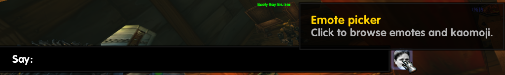
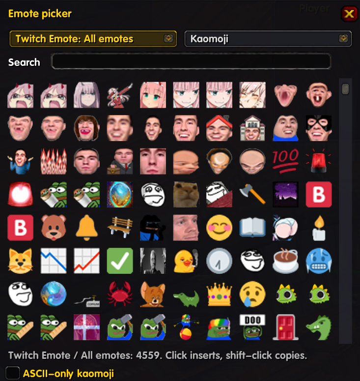
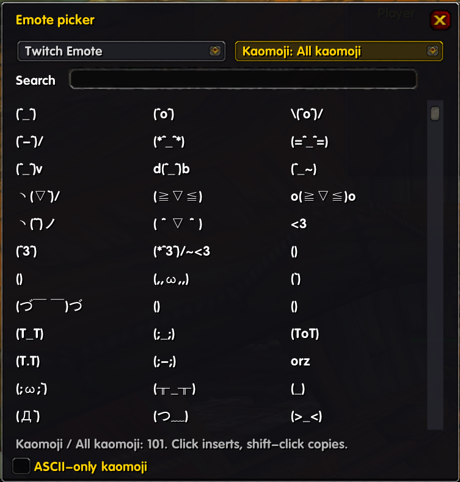
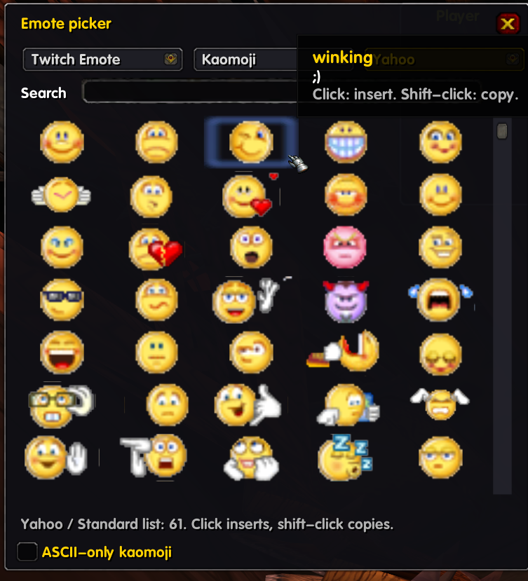

# TwitchEmotes+

A companion add-on for [TwitchEmotes](https://github.com/brues-code/TwitchEmotes), the vanilla 1.12.1 backport by Brues of the retail add-on by Ren. It adds a **scrolling emote picker** opened from a button on the chat edit box, a **kaomoji** (Japanese emoticon) library, and the classic **Yahoo Messenger emoticons** with their original animated art, without modifying a single TwitchEmotes file.

## Required client mod

| DLL | What this add-on uses it for |
|---|---|
| [`ClassicAPI.dll`](https://github.com/brues-code/ClassicAPI) | The Lua 5.1 syntax the add-on is written in, positional script arguments, and `CopyToClipboard` (shift-click copies). Without it only a tiny `Gate.lua` loads and prints a one-line warning, the same way TwitchEmotes gates itself. |

That is the only client mod used. TwitchEmotes states which ClassicAPI version it needs in its own README; check it there, since that changes between releases. TwitchEmotes itself is optional: without it the kaomoji half still works, and the emote packs need it.

## Screenshots

**The button.** It sits at the right end of the chat edit box while you are typing.



**Twitch Emote dropdown.** Every emote from TwitchEmotes in a scrolling grid (4559 in the screenshot), with a container per emote pack.



**Kaomoji dropdown.** Kaomoji and classic text smileys in categories. Plain-ASCII ones render in any font; see [Kaomoji and fonts](#kaomoji-and-fonts) for the others.



**Yahoo dropdown.** The Yahoo Messenger emoticons with their original art; the screenshot shows the Standard list (the 61 emoticons of Yahoo's picker). Hovering an icon shows its English name and its text code, here "winking" and `;)`.



## Features

- **Picker button** beside the chat edit box. It shows while you are typing; `/tep always` keeps it visible.
- **Three separate dropdowns**: **Twitch Emote**, **Kaomoji** and **Yahoo**, each opening a scrolling menu of containers.
  - *Twitch Emote*: Recent, All emotes, then one container per emote pack.
  - *Kaomoji*: Recent, All kaomoji, then one container per category: Happy, Excited, Love, Sad, Angry, Surprised, Confused, Shy, Shrug and meh, Cool and sleepy, Animals, Actions, Table flip, Greetings, Classic smileys, Objects, Extended (needs glyphs).
  - *Yahoo*: Recent, All Yahoo codes, then **Standard list** (the 61 emoticons of Yahoo's picker, in the website table's order), **Hidden emoticons** (the other 36), and 11 themes: Happy and laughing, Love and kisses, Sad hurt and sick, Angry and mischievous, Thinking and doubt, Attitude and reactions, Silly and party, Characters, Animals and creatures, Objects and symbols, Hands and gestures.
- **Virtualized grid.** Only about 80 buttons exist however many emotes are installed, so thousands of emotes scroll smoothly with the mouse wheel or the slider. Long dropdown menus scroll the same way.
- **Packs discovered automatically** from the folder each emote lives in, so packs added by future TwitchEmotes releases show up with no change here.
- **Animated icons** in the grid for sprite-sheet emotes, using the same frame layout as TwitchEmotes.
- **Search** across all emotes, or all kaomoji, depending on which dropdown is active. Kaomoji are searchable by meaning (`shrug`, `hug`, `flip`, `cat`).
- **256 kaomoji and text smileys in 17 categories**, mostly plain ASCII because that is what the default fonts can draw.
- **97 Yahoo Messenger emoticons with their original art**, each with its text code and an English name; search works on the code, the name and the theme. Two art styles: **advanced** (the Yahoo Messenger 9.0 beta pack, 22 px, smoother animation; the default) and **classic** (the original 18 px set). `:ar!` and `[..]` exist only in the classic style and are used in both. Switch with `/tep yahoostyle`. See [Yahoo emoticon art](#yahoo-emoticon-art).
- **Yahoo smileys become images in chat.** Whole-word codes such as `:)`, `>:D<` or `:-bd` in incoming messages are replaced by the animated image (case-insensitive). TwitchEmotes cannot do this itself, so TwitchEmotes+ has its own filter. `|` travels as `||` in WoW chat, and the picker inserts that form. Codes containing `|` or `%` are handled; if you would rather keep Yahoo codes as plain text use `/tep yahoo`.
- **Twitch emotes take priority over Yahoo codes.** Every Yahoo code is checked against all Twitch emote codes (exact match, then ignoring case). A match is **deleted from the Yahoo dropdown** (the footer says how many were removed; the emote is under Twitch Emote) and is left alone in chat for TwitchEmotes to convert. Against the upstream data checked while building this, no Yahoo code matches, so nothing is removed until your install has one; `/tep status` lists any that were.
- **Recent** emotes and kaomoji, remembered between sessions.
- **ASCII-only filter** that hides kaomoji needing special glyphs (191 of the 256 are plain ASCII).
- **Click to insert** at the cursor, **shift-click to copy** to the Windows clipboard.
- **Edit box recovery.** If the chat edit box closes when you click into the search field, what you had typed is restored when you pick something.

### Commands

| Command | Does |
|---|---|
| `/tep` | toggle the picker |
| `/tep status` | show what was detected: TwitchEmotes data, catalog size, client mods |
| `/tep overlap` | report which kaomoji and Yahoo codes are also Twitch emote codes (exact, then ignoring case) and which codes appear in more than one set |
| `/tep ascii` | toggle ASCII-only kaomoji |
| `/tep yahoo` | toggle Yahoo smileys as images in chat |
| `/tep yahooanim` | toggle their animation in chat |
| `/tep yahoostyle [classic\|advanced]` | switch the Yahoo art style (no argument toggles) |
| `/tep always` | keep the button visible even when not typing |

## Kaomoji and fonts

The default 1.12 fonts contain no Japanese or symbol glyphs. In the screenshot above, plain-ASCII kaomoji such as `(T_T)`, `(>_<)` and `orz` render correctly, while characters outside ASCII (kana, hearts, many symbols) can show blank or wrong. The same applies in chat: the kaomoji are sent as UTF-8 and display correctly only where the chat font has the glyphs.

Use the **ASCII-only kaomoji** checkbox (or `/tep ascii`) to hide the 65 that need special glyphs. A chat font with wider glyph coverage makes them render.

## Adding more emotes

Emote art comes from TwitchEmotes, so new emotes are added there, not here. TwitchEmotes ships an installer that takes a BetterTTV emote, converts it to a texture the 1.12 client can decode, and registers it:

```
python tools/add_emote.py https://betterttv.com/emotes/<id> PepeCool
```

TwitchEmotes+ builds its lists from TwitchEmotes' own tables each session, so emotes added that way (and new packs from future releases) should appear in the Twitch Emote dropdown after a `/reload`, with no change here.

New kaomoji go in `Data/Kaomoji.lua` and Yahoo codes in `Data/Yahoo.lua`, or can be supplied by another add-on by overriding the `kaomojiSource` or `yahooSource` service (see below).

## Yahoo emoticon art

The images in `Emotes/Yahoo/` (classic, 97) and `Emotes/YahooAdv/` (advanced, 95) were converted from the Yahoo Messenger emoticon GIFs by `tools/build_yahoo_pack.py`: each GIF becomes one 32-bit uncompressed TGA sprite sheet at its native size, and `Data/Yahoo.lua` is generated alongside (about 8 MB for classic and 15 MB for advanced; they compress to roughly 3 MB). A sheet plays at a single frame rate, so frames the GIF holds longer are repeated (long holds capped), and very long GIFs keep every k-th frame at a rate that preserves the loop length.

- **Code mapping.** The 61 emoticons of Yahoo's picker (the "Standard list") come from an emoticon table; the other 36 are Yahoo's hidden emoticons, taken from a chart of the hidden codes. Each GIF was matched to its code by looking at the image, and every code and image pair was checked against that table and chart. Names are English only.
- **Why a separate chat filter.** TwitchEmotes splits chat on `space , ' < > ? - . !` and inserts each word unescaped into a Lua pattern, so codes containing those or pattern characters (`( ) [ ] * + ? ^ $ % . -`) can neither match nor be registered safely. The Yahoo filter matches whole tokens by plain comparison instead.
- **Rights.** The artwork belongs to Yahoo. If you publish this repository, decide whether to ship `Emotes/Yahoo/`, `Emotes/YahooAdv/` and the generated data; without the images, turn the feature off with `/tep yahoo` and the picker falls back to text.
- **Rebuilding.** `python tools/build_yahoo_pack.py CLASSIC_DIR [ADVANCED_DIR]` (needs Pillow) regenerates the sheets and `Data/Yahoo.lua`.

## Built to survive upstream updates

All coupling to TwitchEmotes lives in `Adapters/Upstream.lua`. Everything else receives its collaborators through a small dependency-injection container (`Core/Container.lua`), so a new TwitchEmotes release can replace the old folder without touching this add-on.

- **Read-only and late-bound.** The adapter reads four TwitchEmotes globals at call time: `emoticons`, `defaultpack`, `TwitchEmotes_animation_metadata` and `ChatFrameEditBox`. Nothing is hooked, wrapped or overwritten, and no TwitchEmotes file is edited.
- **Separate saved variables** (`TwitchEmotesPlusDB`), so the two add-ons never share state.
- **Graceful degradation.** Missing animation metadata gives static icons; missing emote tables give an empty emote menu while kaomoji keep working.
- **Swappable services.** Replace any piece from another add-on without patching this one:

```lua
TwitchEmotesPlus.Container:Override("kaomojiSource", function()
    return { Get = function()
        return { { name = "Mine", items = { { text = "(^_^)", label = "smile" } } } }
    end }
end)
```

| Service | Role |
|---|---|
| `upstream` | late-bound getters for the TwitchEmotes globals |
| `textureResolver` | emote key to texture path, crop and animation data |
| `emoteCatalog` | emotes grouped into packs, sorted, indexed by code |
| `inserter` | puts text into the chat edit box |
| `clipboard` | `CopyToClipboard` wrapper |
| `kaomojiSource` | kaomoji categories |
| `yahooSource` | Yahoo Messenger emoticons: codes, names, containers, sprite-sheet layout for both art styles (generated) |
| `yahooChat` | chat filter and animator for Yahoo smileys |
| `clientMods` | client mod detection for `/tep status` |
| `db`, `picker`, `launcher` | saved variables and UI, wired in `Main.lua` |

If a future TwitchEmotes release renames one of those globals, override `upstream` (and `emoteCatalog` if needed) in a few lines instead of patching the UI.

## What was added compared with stock TwitchEmotes

| | TwitchEmotes | TwitchEmotes+ |
|---|---|---|
| Picker | nested dropdown from the minimap button, paged in 40s | two dropdowns (Twitch Emote, Kaomoji) with scrolling container menus, grid, search, recent, animated icons |
| Entry point | minimap button | button on the chat edit box (minimap button unchanged) |
| Kaomoji and Yahoo emoticons | none | 256 kaomoji and 97 Yahoo emoticons with images, categorised and searchable, Yahoo smileys rendered in chat, Yahoo codes that Twitch emotes already own removed |
| Copy to clipboard | no | shift-click |
| Edits to upstream files | n/a | none |

## Credits

- [TwitchEmotes](https://github.com/brues-code/TwitchEmotes): originally written for retail by Ren, backported to vanilla by Brues. All emote art and data come from it.
- [ClassicAPI](https://github.com/brues-code/ClassicAPI) by Brues.
- Yahoo Messenger emoticons: the codes follow Yahoo's own list; artwork by Yahoo (classic set and the Yahoo Messenger 9.0 beta advanced emoticon pack).
